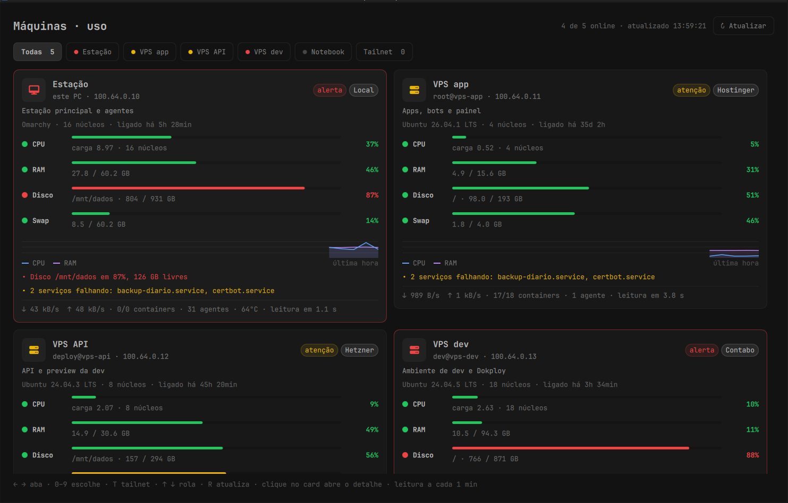
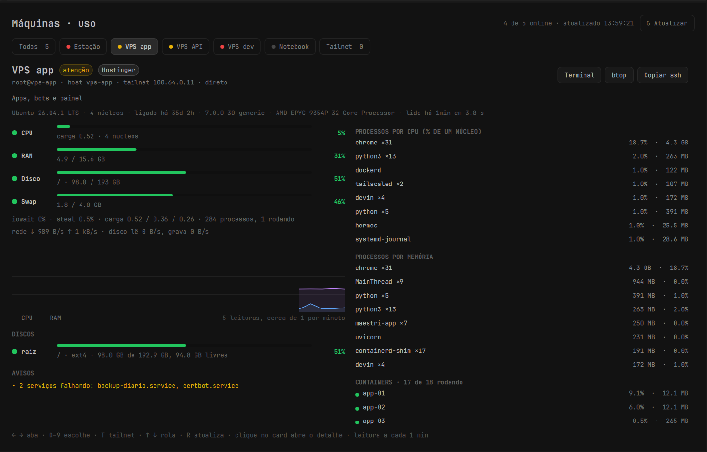

# Radar de máquinas

O uso de cada máquina sua (PC, notebook e VPS) na barra do Omarchy, um card por máquina, no mesmo formato do [Radar 9Router](https://github.com/LucasOl1337/omarchy-9router-radar).

O ícone de servidor abre uma grade com CPU, RAM, o disco mais cheio e swap, cada barra verde, amarela ou vermelha, um gráfico da última hora e os avisos que pedem atenção: disco acima de 85%, memória acima de 90%, carga alta, steal de VPS disputada, serviços do systemd falhando e containers sem saúde. O ícone acende quando alguma VPS não responde ou tem aviso vermelho.



Clicar num card abre o detalhe: processos que mais gastam CPU e memória (agrupados pelo nome), containers do Docker, agentes de IA abertos, GPU, discos, rede e IO. Os botões abrem um terminal com `ssh` na máquina, abrem o `btop` dela ou copiam o comando. A aba Tailnet lista todos os aparelhos da sua rede Tailscale, com o caminho de cada um (direto ou relay).



Novidades de cada versão em [docs/releases](docs/releases/).

## Instalar

Requer Omarchy com Quickshell e plugins, Python 3 e systemd do usuário. Nas máquinas remotas basta `python3` e acesso SSH sem senha interativa (chave no agente ou sem passphrase). Nada é instalado nelas. Tailscale, Docker e `nvidia-smi` são opcionais. Node.js é necessário só pra rodar os testes do modelo.

```bash
git clone https://github.com/LucasOl1337/omarchy-machines-radar.git
cd omarchy-machines-radar
mkdir -p ~/.config/omarchy-machines
cp machines.example.json ~/.config/omarchy-machines/machines.json
# Edite o arquivo com suas máquinas.
python3 install.py
```

Cada máquina do cadastro tem:

- `id` e `name`: identificador e nome no painel.
- `local: true` pra máquina onde a barra roda, ou `ssh` com um alias do `~/.ssh/config` (ou `usuario@host`).
- `provider` e `role` (opcionais): selo do provedor e uma linha dizendo pra que a máquina serve.
- `kind` (opcional): `local` pra notebook ou desktop. Desligado vira cinza, sem alarme. VPS fora do ar fica vermelha.
- `tailnet` (opcional): nome do aparelho no Tailscale, quando difere do hostname.

Sem cadastro, o radar usa o `machines.example.json`.

## Como lê

A cada minuto o timer roda `collect.py`, que manda `probe.py` pela entrada padrão de `ssh ALIAS python3 -` pra todas as máquinas em paralelo (só biblioteca padrão; na máquina local roda direto). O probe mede CPU, IO e rede numa janela de um segundo em `/proc` e lê memória, discos, temperatura, `docker ps`/`docker stats`, `systemctl --failed`, `nvidia-smi` e `tailscale ip`. Uma máquina sem resposta mantém a última leitura boa, marcada com a idade e o erro.

Processos aparecem só pelo nome curto (`comm`), nunca pela linha de comando, pra não vazar argumentos e tokens. O estado não guarda senhas nem variáveis de ambiente.

## Arquivos e operação

- Fonte: diretório do clone deste repositório.
- Plugin ativo: `~/.config/omarchy/plugins/lol.machines/`.
- Cadastro: `~/.config/omarchy-machines/machines.json`.
- Estado: `~/.local/state/omarchy-trackers/machines/status.json`, modo 0600, com cerca de uma hora de histórico.
- Timer: `omarchy-machines.timer`, uma leitura por minuto depois da anterior.

```bash
python3 install.py
systemctl --user status omarchy-machines.timer
systemctl --user start omarchy-machines.service
node --test tests/test_model.cjs
python3 -m unittest discover -s tests -v
```

O instalador publica a interface em `.runtime/<hash>/` e troca o manifesto depois de copiar todos os imports. Isso evita que a barra mantenha QML antigo em cache durante uma atualização.

Clique no ícone pra abrir; botão do meio ou R atualizam e Esc fecha. Setas ← → trocam de aba, 0 a 9 escolhem direto (0 é Todas), T abre a Tailnet e ↑ ↓ rolam. A aba fica lembrada em `~/.local/state/omarchy-trackers/machines/view.json`.

Pra conferir o que a barra carregou:

```bash
quickshell ipc -p /usr/share/omarchy/shell call lol.machines diagnostics
quickshell ipc -p /usr/share/omarchy/shell call lol.machines select vps1
```

Licença MIT.
